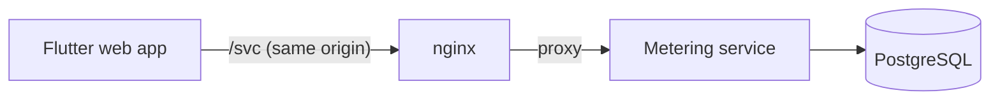

# 📊 Usage Metering and Quota Service

A backend service that other applications call to **track usage and decide whether a user may perform an action**. A calling application (an *account*) has a shared monthly allowance, each of its users has an individual allowance, and every request is checked against **both**. The decision is recorded, explained, and counted only if accepted.

Built with TypeScript, Express and PostgreSQL. Includes a working example application (Flutter web), a full Docker Compose stack, 302 automated tests, and a load-testing toolkit that verifies correctness after every run.

<br>

## 📑 Table of Contents

- [🎯 Overview](#overview)
- [💡 What This Project Demonstrates](#demonstrates)
- [✨ Features](#features)
- [🧰 Tech Stack](#tech-stack)
- [🏗️ Architecture](#architecture)
- [🚀 Quick Start](#quick-start)
- [🎬 Demo Walkthrough](#demo)
- [🔑 Accounts, Users, Plans and API Keys](#model)
- [📏 Rules and Decision Semantics](#rules)
- [📚 API Documentation](#api)
- [🧭 Design Decisions](#design)
- [📝 Product Assumptions](#assumptions)
- [🧪 Testing](#testing)
- [⚡ Performance](#performance)
- [⚠️ Known Limitations](#limitations)
- [🛠️ What I Would Do Next](#next)
- [🗂️ Repository Structure](#structure)
- [🤖 How This Was Built](#how)
- [📞 Contact](#contact)

<br>

---

<br>

<a id="overview"></a>

## 🎯 Overview

Imagine a company running a document processing application. The company has a shared monthly allowance and each user has an individual one. Before processing a document, the application's backend asks this service to consume units for a user. The service checks **both** allowances, records the decision, and counts the usage only if the request is accepted.

The repository contains three parts:

| Part | Folder | What it is |
| :-- | :-- | :-- |
| Metering service | [`service/`](service) | The backend: accounts, users, plans, consume, usage, history. TypeScript, Express 5, PostgreSQL. |
| Example application | [`client/`](client) | A small "document processing" Flutter web UI served by nginx (proxies `/svc` to the service). See [`client/README.md`](client/README.md). |
| Load tests | [`perf/`](perf) | autocannon scenarios that verify correctness with SQL after every run. See [`docs/performance.md`](docs/performance.md). |

<br>

---

<br>

<a id="demonstrates"></a>

## 💡 What This Project Demonstrates

Each point below is backed by something in the repository that you can run or read.

1. **Correct accounting under concurrency.** Every consume runs in one database transaction, locks the account counter row and then the user counter row (always in that order), and updates both counters only if the request is accepted. Concurrency tests fire 50 parallel requests at an allowance that fits exactly 10, and assert that exactly 10 are accepted and that the three records of usage (account counter, user counters, request log) agree.
2. **Safe retries.** The request identifier is an idempotency key, unique per account. A retry returns the original decision with `replayed: true` and never counts twice. Reusing an identifier with a different payload returns `409`.
3. **Data integrity enforced by the database, not only by code.** Check constraints, unique constraints and a composite foreign key make invalid states (a request logged for a user of another account, a half-filled rejection, a period that is not the first of a month) impossible to store. Tests insert invalid rows directly with SQL to prove each rule.
4. **Account isolation.** The API key identifies the account; every query filters by it; resources of other accounts answer `404`.
5. **A testing strategy that matches the risks.** No mocks of the database, tests against a real PostgreSQL in an isolated test database, contract tests that pin response shapes, migration tests on an empty database, process-level startup and shutdown tests, and a manual mutation check during development (removing the row locks made the concurrency tests fail; the mutation was reverted and is not in the repository).
6. **Measured, honest performance work.** The load tests verify the invariants after every run, identify the bottleneck (one hot account row), and document one measured change together with the alternatives that were rejected and why. See [`docs/performance.md`](docs/performance.md).
7. **Reproducible local setup.** One command starts PostgreSQL, the service (migrations and predefined plans run at startup) and the example application, with health-check based startup ordering.

<br>

---

<br>

<a id="features"></a>

## ✨ Features

Everything in the assignment brief is implemented:

- **Accounts and users.** Create accounts (an API key is issued once), register users under an account, assign or change their plans. Usage of different accounts and users is kept separate.
- **Predefined plans** created at startup: two for accounts (Starter, Pro) and two for users (Basic, Premium). They are read-only.
- **Custom plans.** An account can create, view and update its own plans and assign them to itself or to its users. Several users can share one plan definition and still have separate usage totals. Plan edits apply to the next request, with no restart.
- **Consume units.** Accepts a user identifier, a positive whole number of units and a request identifier. The full amount is accepted only if every applicable account and user rule allows it. A rejection consumes nothing.
- **Explained decisions.** A rejection names the rule (`max_per_request` or `monthly_allowance`) and the level (`account` or `user`) that stopped it.
- **Usage and history.** Consumed and remaining units for the account and each user, any UTC month; paginated request history with filters.
- **Persistence.** Everything is stored in PostgreSQL and survives restarts (Docker volume).
- **Example application and Docker Compose.** `docker compose up --build` starts the whole stack.
- **Automated tests and load tests.** See [Testing](#testing) and [Performance](#performance).

<br>

---

<br>

<a id="tech-stack"></a>

## 🧰 Tech Stack

| Area | Choice |
| :-- | :-- |
| Language | TypeScript (strict mode) on Node.js 22 |
| HTTP | Express 5 |
| Database | PostgreSQL 16, plain SQL migrations, `pg` driver (no ORM) |
| Validation | Zod |
| Logging | pino |
| Tests | Vitest, Supertest, real PostgreSQL |
| Example application | Flutter web (static UI served by nginx) |
| Load tests | autocannon, driven from TypeScript |
| Packaging | Docker multi-stage builds, Docker Compose |

<br>

---

<br>

<a id="architecture"></a>

## 🏗️ Architecture



Inside the service, a request always flows in one direction:

`routes` → `controller` → `service` → `repository` → `database`

- **Routes** declare URLs and the middleware order (authentication, validation).
- **Controllers** deal with HTTP only.
- **Services** hold the business logic and know nothing about Express.
- **Repositories** contain SQL only.
- The decision logic is a **pure function** (`rule_evaluator.ts`): plain data in, decision out, no database. It is the part that is easiest to test and to change.

How one consume request is processed (one database transaction):

1. Check that the user belongs to the authenticated account (otherwise `404`).
2. Lock the account counter row for the current UTC month, then the user counter row, always in that order (a missing row is created first).
3. Look for an earlier request with the same identifier: return the stored decision (a replay) or `409` if the payload differs.
4. Load the account plan and the user plan, so the decision uses the newest committed plan values.
5. Evaluate the rules with the pure evaluator.
6. If accepted, add the units to both counters.
7. Store the decision and the limits that applied in the request log, and commit.

More detail and the reasons behind each choice: [`docs/design_decisions.md`](docs/design_decisions.md).

<br>

---

<br>

<a id="quick-start"></a>

## 🚀 Quick Start

**Requirements:** Docker with Compose v2 (`docker compose`), and free ports `3000`, `5432` and `8080`.

```bash
git clone https://github.com/mahmoudjawad02025/usage_metering_platform.git
cd usage_metering_platform
docker compose up --build
```

The first build takes a few minutes because it downloads a Flutter image. No `.env` file is needed: every setting has a default (see below).

| What | Where |
| :-- | :-- |
| Example application (open this) | http://localhost:8080 |
| Metering service | http://localhost:3000 (health check: `/health`) |
| PostgreSQL | `localhost:5432` |

Startup order is enforced with health checks: PostgreSQL becomes healthy, then the service (it runs the migrations and creates the predefined plans), then the example application (static UI). Click **Create demo account** in the UI to provision the demo data through the public API.

**Stop and keep the data:** `docker compose down`. **Stop and delete all data:** `docker compose down -v`.

**Create an account yourself** (the admin key creates accounts, the API key it returns is shown only once):

```bash
curl -s -X POST http://localhost:3000/accounts \
  -H "x-admin-key: change_me_to_a_long_random_admin_key" \
  -H "content-type: application/json" \
  -d '{"name":"My App"}'
```

> The default admin key and database password exist only to make the local demo work without configuration. Never use them anywhere else.

**Configuration** (all optional, defaults in the Compose file; copy `.env.example` to `.env` to change them):

| Variable | Used by | Default | Meaning |
| :-- | :-- | :-- | :-- |
| `ADMIN_KEY` | service | `change_me_to_a_long_random_admin_key` | Static key that is allowed to create accounts (at least 16 characters); typed once in the demo UI |
| `POSTGRES_USER`, `POSTGRES_PASSWORD`, `POSTGRES_DB` | PostgreSQL, service | `usage_metering`, `usage_metering_password`, `usage_metering_service` | Database credentials |
| `DB_POOL_MAX` | service | `10` | Maximum database connections of the service |
| `LOG_LEVEL` | service | `info` | pino log level |
| `SERVICE_PORT`, `POSTGRES_PORT`, `CLIENT_PORT` | Compose | `3000`, `5432`, `8080` | Published ports on your machine |

**Run the service without Docker (development):**

```bash
cp .env.example .env              # PowerShell: Copy-Item .env.example .env
docker compose up -d postgres
cd service
npm install
npm run dev                       # http://localhost:3000
```

**Run the tests:** see [Testing](#testing).

<br>

---

<br>

<a id="demo"></a>

## 🎬 Demo Walkthrough

Open http://localhost:8080. The example application is a simulated document processing app. Click **Create demo account** (admin key; default matches `.env.example`). That uses only the public API to create an account, a tiny custom account plan (100 units per month, 50 per request), and two users: `alice` on **Basic** (1000 per month, 20 per request) and `bob` on **Premium** (10000 per month, 200 per request).

| # | Action in the UI | Result |
| :-- | :-- | :-- |
| 0 | Create demo account | Account, plans, and users are ready; API key stays in the browser. |
| 1 | alice, 10 units | Accepted. alice 10 used, 990 remaining. Account 10 used, 90 remaining. |
| 2 | alice, 25 units | Rejected by the **user's** per-request limit (Basic allows 20). Nothing consumed. |
| 3 | bob, 50 units | Accepted. Account 60 used, 40 remaining. |
| 4 | bob, 50 units again | Rejected by the **shared account's** monthly allowance (40 remaining), although bob's own plan has plenty left. |
| 5 | Switch alice to the custom plan "Demo Boost", then alice, 25 units | Accepted. The same request that failed in step 2 now succeeds. |
| 6 | Switch the account to **Pro**, then bob, 50 units | Accepted. |
| 7 | "Retry last request" | The stored decision comes back with `replayed: true`; no unit is counted twice. |

Steps 5 and 6 change what users can do **without any change to the client code**: the client only lists the plans the service returns and lets you assign them. For this local demo the API key is kept in the browser (localStorage); a real application would call the service from its backend. Details: [`client/README.md`](client/README.md).

<br>

---

<br>

<a id="model"></a>

## 🔑 Accounts, Users, Plans and API Keys

| Concept | Meaning |
| :-- | :-- |
| **Account** | An application or company calling the service. Its plan defines limits **shared by all its users**. |
| **User** | A user of that application, registered under an account. Its plan defines **individual** limits. |
| **Plan** | A named set of rules (monthly allowance, maximum units per request). It is either for accounts or for users, never both. |
| **Units** | The amount consumed by an action. One resource is used throughout the project. |

The two plans apply together. Giving a user a larger allowance does not raise the account's shared allowance.

**Predefined plans** (read-only, created at startup):

| Plan | Applies to | Monthly allowance | Maximum per request |
| :-- | :-- | --: | --: |
| Starter (default for accounts) | account | 10,000 | 100 |
| Pro | account | 100,000 | 1,000 |
| Basic (default for users) | user | 1,000 | 20 |
| Premium | user | 10,000 | 200 |

**API keys**

1. Accounts are created with `POST /accounts`, protected by the `x-admin-key` header (there is no account to authenticate with yet, so a static `ADMIN_KEY` environment variable is used).
2. The response contains the API key **once**. Only its SHA-256 hash is stored.
3. All other endpoints require the key in the `x-api-key` header. The key identifies the account and gives access only to that account's data. Missing or invalid keys return `401`.
4. Any user or plan identifier that belongs to another account behaves as if it did not exist (`404`).

<br>

---

<br>

<a id="rules"></a>

## 📏 Rules and Decision Semantics

Two rule types exist, for both account plans and user plans:

1. **Monthly allowance:** the total units available during a UTC calendar month.
2. **Maximum units per request:** the largest amount that one request may consume.

Every request must satisfy **both** plans. Examples from the brief, as implemented:

- Account: 10,000 per month and 100 per request. User: 1,000 per month and 20 per request.
- A request for **25 units** is rejected by the user's per-request limit, even if both monthly allowances have enough left.
- A request for **10 units** is accepted when both have enough left. It adds 10 to the user's usage and 10 to the account's usage.
- If the account has only 5 units left, a request for 10 is rejected, even if the user has plenty left.

**Behavior worth knowing**

- **All or nothing.** The full amount is accepted or the request is rejected and nothing is consumed.
- **Which rule is reported.** When several rules fail, the first one in this fixed order is reported: user per-request, account per-request, user monthly, account monthly.
- **Rejections are HTTP 200** with `"accepted": false`. A rejection is a normal answer of a quota check; 4xx codes are for problems with the request itself.
- **UTC months.** Usage belongs to the UTC month in which the request is processed. A new month starts at zero for both levels, and previous months stay available for queries. There is no reset job: a new month is simply a new counter row.
- **Plan changes** apply to new requests after the update succeeds. Editing a custom plan affects everything assigned to it. Switching plans keeps the units already consumed and does not grant a fresh allowance.
- **Allowance lowered below existing usage:** remaining is shown as `0` (never negative), and further consumption at that level is rejected until allowance is available again.
- **Retries.** Same `requestId` and same payload: the original decision is returned with `replayed: true`, balances as at the time of the decision. Same `requestId` with a different `userId` or `units`: `409 REQUEST_ID_REUSED`. A rejected request is also stored, so retrying it returns the same rejection even if the plan changed since.
- **History keeps the truth.** Each logged request stores the limits and counters that applied when it was decided, so history stays correct after plans change.

<br>

---

<br>

<a id="api"></a>

## 📚 API Documentation

The full reference, with request fields, responses, error codes and `curl` examples for every endpoint, is in:

**➡️ [`docs/api.md`](docs/api.md)**

Overview:

| Area | Endpoints |
| :-- | :-- |
| Health | `GET /health` |
| Accounts | `POST /accounts` (admin key), `GET /accounts/me`, `PUT /accounts/me/plan` |
| Plans | `GET /plans`, `POST /plans`, `GET /plans/:id`, `PATCH /plans/:id` |
| Users | `POST /users`, `GET /users`, `GET /users/:id`, `PUT /users/:id/plan` |
| Usage | `POST /usage/consume`, `GET /usage`, `GET /usage/users/:userId`, `GET /usage/history` |

A first consume call:

```bash
curl -s -X POST http://localhost:3000/usage/consume \
  -H "x-api-key: $API_KEY" \
  -H "content-type: application/json" \
  -d '{"userId":"<user id>","units":10,"requestId":"doc-1"}'
```

```json
{
  "accepted": true,
  "replayed": false,
  "requestId": "doc-1",
  "units": 10,
  "period": "2026-10",
  "rejection": null,
  "account": { "plan": { "id": "…", "name": "Starter", "monthlyAllowance": 10000, "maxPerRequest": 100 }, "consumed": 10, "remaining": 9990 },
  "user": { "id": "…", "plan": { "id": "…", "name": "Basic", "monthlyAllowance": 1000, "maxPerRequest": 20 }, "consumed": 10, "remaining": 990 }
}
```

The API documentation is written by hand. The shapes in it are pinned by contract tests (`service/tests/integration/api_contract.test.ts`), so a change to a response shape fails a test. There is no OpenAPI file (see [Known Limitations](#limitations)).

<br>

---

<br>

<a id="design"></a>

## 🧭 Design Decisions

The short version. The reasons, alternatives and trade-offs are in [`docs/design_decisions.md`](docs/design_decisions.md).

1. **Counter tables plus a request log, instead of summing the log.** Reading usage is one row; the log is the audit trail (idempotency, rejection reasons, history).
2. **Row locks in PostgreSQL for correctness.** Locking the account row and then the user row serializes competing requests and prevents deadlocks by always locking in the same order. No in-process locks, so correctness does not depend on how many service instances run.
3. **Plans are read inside the transaction.** Nothing is cached, so a plan edit applies to the very next request without a restart.
4. **Plan and usage are separate data.** That is why switching plans keeps usage, lowering an allowance gives zero remaining, and nothing needs special code.
5. **The decision logic is a pure function** with an ordered list of rule checks. Adding a rule means adding one check, one nullable column on `plans`, and tests.
6. **Constraints in the schema** as the last line of defense: even a bug in the code cannot store an invalid state.
7. **The new month needs no job.** The period is part of the counter key.
8. **API keys are stored as SHA-256 hashes**, which is appropriate for a random 256-bit key and allows an indexed lookup on every request (a slow password hash would not).
9. **Rejections return 200; foreign resources return 404.** Documented in the API reference.

<br>

---

<br>

<a id="assumptions"></a>

## 📝 Product Assumptions

The brief leaves some behavior open. These are the choices made, applied consistently:

1. **Account creation** is protected by a static `ADMIN_KEY` environment variable, because no account exists yet to authenticate with. Role-based permissions are out of scope in the brief.
2. **`userId` in consume is the service's UUID** returned when the user is registered. The application's own identifier is stored as `externalId` (unique per account) for mapping.
3. **Request identifiers** are unique per account and never expire.
4. **Rejections are HTTP 200**; only problems with the request use 4xx.
5. **Rule precedence** when several rules fail: user per-request, account per-request, user monthly, account monthly.
6. **A foreign or unknown resource gives 404**, not 403, so existence is not revealed. A wrong plan scope (a user plan for an account, or the reverse) gives `400 PLAN_SCOPE_MISMATCH`. Editing a predefined plan gives `403 PLAN_READ_ONLY`.
7. **Plan names** are unique per owner and scope. A custom plan may reuse the name of a predefined plan.
8. **Plan scope cannot be changed** after creation.
9. **Units** must be a whole number from 1 to 1,000,000,000. Allowances are limited to the same maximum.
10. **Remaining units of a past month** are calculated against the plan limits that apply now (plans are not versioned). The request history keeps the exact limits that applied at decision time.
11. **Predefined plan limits** are the ones in the table above, chosen as sensible examples. Premium's per-request limit (200) is intentionally above Starter's (100) to show that a larger user limit does not raise the account's limit.
12. **No additional rule types** beyond the two required ones were built. The evaluator is structured so that one can be added in a few places (see the design document).

<br>

---

<br>

<a id="testing"></a>

## 🧪 Testing

302 automated tests run against a real PostgreSQL database (a separate `..._test` database that the test setup creates, so your development data is never touched).

```bash
docker compose up -d postgres      # PostgreSQL must be running
cd service
npm install
npm test                           # all tests
npm run test:unit                  # pure logic, no database
npm run test:integration           # HTTP + database
npm run test:coverage              # also enforces coverage thresholds
```

`npm test` reads `../.env`: copy `.env.example` to `.env` first.

What is covered:

| Area | Examples |
| :-- | :-- |
| API key validation and account isolation | Every protected route rejects missing and invalid keys; no cross-account read, edit or assignment |
| Consume rules | The brief's three examples, all-or-nothing, shared plans with separate totals, account limit not raised by a larger user limit |
| Idempotency | Same decision on retry, `409` on reuse with a different payload, replay across months |
| Concurrency | 50 parallel requests accept exactly as many as the allowance allows; 20 identical requests count once |
| Plan changes | Edits apply immediately, lowered allowance, switching keeps usage, history keeps old limits |
| UTC months | Boundary at midnight, year change, fresh allowance, history by month |
| Database rules | Every constraint is exercised with raw SQL, both the rejecting and the accepting side |
| Startup | Migrations on an empty database, repeated, concurrent and failing; configuration errors; graceful shutdown of the real process |
| Contracts | The exact shape of every public response and of the predefined plan limits |

Notes on method:

- The database is **not mocked**. One test injects a fault (the log insert fails after the counters were updated) to prove that a failed request leaves no trace and that the retry then succeeds.
- A **mutation check** was performed manually during development: removing the row locks from lockCounters made the concurrency tests fail, confirming they really test locking. (The mutation was reverted; it is not part of the repository.)
- Coverage thresholds enforced by `npm run test:coverage`: lines 95%, statements 93%, functions 90%, branches 85%.
- The example application has Flutter model tests and was verified manually with the walkthrough above.

<br>

---

<br>

<a id="performance"></a>

## ⚡ Performance

The load tests are in [`perf/`](perf), driven by autocannon. They create all data through the public API, send `POST /usage/consume` load, and then **verify correctness with SQL**: account counter = sum of user counters = sum of accepted units in the log, no counter above its allowance, and one log row per successful response. A run fails if any check fails.

| Scenario | What it shows |
| :-- | :-- |
| `spread` | 20 accounts x 50 users: capacity when accounts do not block each other |
| `hot-account` | 1 account x 100 users: every request locks the same counter row |
| `hot-account-limited` | Small allowance, most requests rejected: the allowance is never exceeded under heavy competition |
| `hot-user-limited` | The same at the user level |

**The main finding: one hot account is the bottleneck.** Every consume locks the account counter row until commit, so one account is served one request at a time, and its throughput is roughly one divided by the time the lock is held. More connections only lengthen the queue. Different accounts do not block each other. This is the price of exact allowances with a simple design; the real fix (sharded counters) is listed under [What I Would Do Next](#next).

Measured results, the connection-pool experiment, the one improvement that was measured (fewer database round trips inside the locked section) and the ideas that were rejected are in **[`docs/performance.md`](docs/performance.md)**, with raw files in [`perf/results`](perf/results).

Run them yourself:

```bash
docker compose up -d --build postgres service
cd perf
npm install
LABEL=my-run npm run load:consume          # PowerShell: $env:LABEL="my-run"; npm run load:consume
LABEL=my-run npm run load:contention
npm run summarize                          # writes perf/results/summary.md
```

Honest limits of these tests: the load generator is closed-loop (fixed connections), everything runs on one machine, and the data set is small. Absolute numbers depend on hardware; comparisons between labels on the same machine are the reliable part.

<br>

---

<br>

<a id="limitations"></a>

## ⚠️ Known Limitations

1. **Hot account contention.** All requests of one account lock one counter row, so one account's throughput is limited by the time that lock is held.
2. **No key rotation or revocation.** A lost key cannot be replaced for an existing account.
3. **No expiry of request identifiers or history.** The log grows forever. Production would archive old rows.
4. **Offset pagination.** Simple, as the brief allows, but a very large offset is slow and rows inserted while paging can shift pages. Keyset pagination would fix it.
5. **Plans are not versioned.** Past months' remaining units use today's plan limits. The history keeps the exact limits that applied.
6. **Limited management operations.** No endpoints to delete accounts, users or plans, or to rename or remove users. History is protected by foreign keys with no cascade.
7. **Simple admin model.** One static admin key from the environment, no roles, no rate limiting, no TLS.
8. **Default credentials** (admin key, database password) exist for the local demo only.
9. **Single instance tested.** Correctness relies on database locks and constraints, not on process memory, so multiple instances should behave the same, but the load tests ran against one service instance.
10. **Migrations are forward-only** (no down migrations).
11. **Example application.** The example keeps its API key in browser localStorage (demo only); the demo skips its simulated work on a replayed request; the Flutter build loads its engine from a CDN.
12. **Docker images use moving tags** (`stable`, `22-alpine`, `16-alpine`) for simple setup, which trades away exact reproducibility.
13. **No OpenAPI file.** The API reference is written by hand and protected by contract tests.

<br>

---

<br>

<a id="next"></a>

## 🛠️ What I Would Do Next

1. **Sharded counters** to remove the hot account row (several counter rows per account, with a reservation scheme per shard), accepting a less exact limit near the boundary.
2. **Key rotation and revocation**, then a short cache for the key lookup.
3. **Keyset pagination** for the history.
4. **Versioned plans**, so past months can be shown against the limits that really applied.
5. **An OpenAPI description generated from the Zod schemas**, served as interactive documentation.
6. **An additional rule type** (for example a daily cap) using the existing evaluator design.
7. **Load tests from a second machine** and with a database that already holds millions of log rows.

<br>

---

<br>

<a id="structure"></a>

## 🗂️ Repository Structure

```
usage_metering_platform/
├── docker-compose.yml          # PostgreSQL + service + example application
├── .env.example                # every setting, with defaults
├── docs/
│   ├── api.md                  # API reference with curl examples
│   ├── design_decisions.md     # schema, consume algorithm, concurrency, trade-offs
│   └── performance.md          # load test method, results, bottleneck, lessons
├── service/                    # the metering backend
│   ├── Dockerfile
│   ├── src/
│   │   ├── server.ts           # migrate, then listen
│   │   ├── app.ts              # builds the Express app (testable, no port)
│   │   ├── config/             # validated environment variables
│   │   ├── db/                 # pool, transaction helper, migration runner, SQL migrations
│   │   ├── core/               # errors, middleware, utilities (API keys, UTC period, pagination)
│   │   └── modules/            # accounts, users, plans, usage (+ rule_evaluator.ts), history
│   └── tests/                  # unit and integration tests, helpers
├── client/                     # example application
│   ├── Dockerfile
│   ├── nginx.conf              # serves the UI and proxies /svc to the service
│   └── demo/                   # Flutter web UI
└── perf/                       # load tests
    ├── scripts/                # scenarios, seeding, invariant verification
    └── results/                # committed result files and summary
```

<br>

---

<br>

<a id="how"></a>

## 🤖 How This Was Built

This project was built with the help of AI tools, which the assignment explicitly allows. I worked phase by phase: each phase was run, tested and committed before the next one started. The decisions, trade-offs and limits are written down in this README and in [`docs/design_decisions.md`](docs/design_decisions.md) so they can be discussed and challenged. Everything claimed here is backed by a test, a result file, or a command you can run.

<br>

---

<br>

<a id="contact"></a>

## 📞 Contact

- 📧 Email: [mahmoudjawad02025@gmail.com](mailto:mahmoudjawad02025@gmail.com)
- 💻 GitHub Profile: [@mahmoudjawad02025](https://github.com/mahmoudjawad02025)
- 💼 LinkedIn: [linkedin.com/in/mahmoud-abu-alsebaa](https://www.linkedin.com/in/mahmoud-abu-alsebaa)