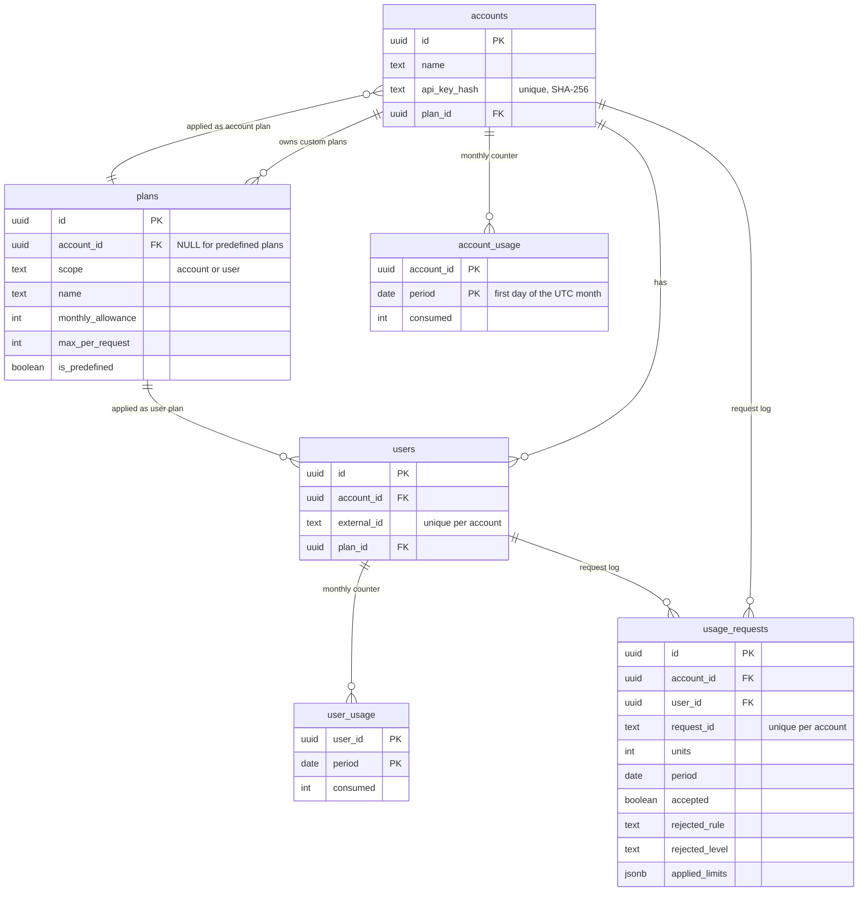

# Design Decisions

Usage Metering and Quota Service. Schema, algorithm, concurrency, idempotency, trade-offs and limits.

[Back to the project README](../README.md) · [API reference](api.md) · [Performance](performance.md)

## Table of Contents

1. [Purpose of This Document](#purpose)
2. [Requirements to Design Map](#requirements-map)
3. [Architecture and Code Organization](#architecture)
4. [Data Model](#data-model)
    1. [Entity relationships](#entity-relationships)
    2. [Tables and why each exists](#tables)
    3. [Constraints as the last line of defense](#constraints)
    4. [Why the plan relationships look the way they do](#plan-relationships)
5. [The Consume Algorithm](#consume)
6. [Concurrency Control](#concurrency)
7. [Idempotency and Retries](#idempotency)
8. [Rule Evaluation and How to Add a Rule](#rules)
9. [Plan Changes](#plan-changes)
10. [Time and Monthly Periods](#time)
11. [Security Model](#security)
12. [Errors and Status Codes](#errors)
13. [Testing Strategy](#testing)
14. [Performance Decisions](#performance)
15. [Alternatives Considered](#alternatives)
16. [Known Limitations and Trade-offs](#limitations)
17. [What Was Measured and What Was Reasoned](#provenance)

## Purpose of This Document

The README says what the service does. This document explains **why it is built this way**, what was rejected, and where the design is weak. Every claim here is meant to be checkable: against a test, a result file in `perf/results`, or the code.

## Requirements to Design Map

| Requirement of the brief | Design decision | Where to look |
| :-- | :-- | :-- |
| Two plans apply together | One pure function checks both plans; both counters change in the same transaction | `modules/usage/rule_evaluator.ts`, `usage.service.ts` |
| Two rule types | An ordered list of rule checks | `rule_evaluator.ts` (`RULE_CHECKS`) |
| A rejection consumes nothing | The decision is made before any counter changes; any failure rolls back | `usage.service.ts`, `transaction.test.ts` |
| Account usage = sum of user usage | Both counters are incremented in the same statement | `usage.repository.ts` (`incrementCounters`), invariant checks in `perf/` |
| Users sharing a plan keep separate totals | Counters are keyed by user and month, never by plan | `user_usage` table |
| UTC calendar month, fresh month starts at zero | The month is part of the counter key; no reset job | `utc_period.ts`, `account_usage`, `user_usage` |
| Allowance lowered below usage: zero remaining | `remaining = max(0, allowance - consumed)`; the stored counter is never rewritten | `remainingUnits` |
| Switching plans keeps usage | The plan is a reference on the account or user; counters are separate rows | `plan_changes.test.ts` |
| Plan changes apply without redeploy | Plans are read inside the consume transaction; nothing is cached | `getPlans` in `usage.repository.ts` |
| Past request history is preserved | Each log row stores the limits and counters that applied | `usage_requests.applied_limits` |
| Safe retries | Unique `(account_id, request_id)` and a stored decision | `usage_requests`, `idempotency.test.ts` |
| Competing requests handled correctly | Row locks, always account row first, then user row | `lockCounters`, `concurrency.test.ts` |
| The API key grants access to one account only | Key identifies the account; every query filters by it; foreign resources give 404 | `authenticate_api_key.middleware.ts`, `auth_and_isolation.test.ts` |
| Validate that a user belongs to the account | Checked in the transaction, and enforced again by a composite foreign key | `userBelongsToAccount`, `usage_requests_user_belongs_to_account` |
| Predefined plans at startup, read-only | Seeded by a migration; edits answer 403 and the SQL update also refuses them | `003_seed_predefined_plans.sql`, `updateOwnedPlan` |
| Custom plans | `plans.account_id` marks the owner; visibility rule in one SQL filter | `plans.repository.ts` |
| Explain decisions | The rejection names rule, level, limit and remaining | `describeRejection` |
| Usage per month and history with pagination | Counter rows for reads; request log for history | `GET /usage`, `GET /usage/history` |
| Data survives a restart | Everything in PostgreSQL on a named volume | `persistence.test.ts`, `docker-compose.yml` |
| Database setup at startup | Migrations run before the port is opened | `server.ts`, `migrate.ts` |

## Architecture and Code Organization

A request flows in one direction: `routes` then `controller` then `service` then `repository` then the database.

1. **Routes** declare URLs and middleware order (authentication, then validation).
2. **Controllers** read the request and write the response. They contain no business rules.
3. **Services** hold the business logic. They do not import Express.
4. **Repositories** contain SQL only. A repository function that takes a `PoolClient` always runs inside the caller's transaction.

Three structural choices are deliberate:

1. **`app.ts` and `server.ts` are separate.** Tests import `createApp()` and use Supertest without opening a port. Only `server.ts` runs migrations, opens the port and handles shutdown.
2. **The decision logic is a pure function.** `evaluateRules` takes plain numbers and returns a decision. It has no database, clock or network, so it is tested with unit tests that run in milliseconds, and it is the safest place to change a rule.
3. **No ORM.** The queries that matter (locking reads, the combined plan query, the combined counter update) are plain SQL, visible and reviewable. The cost is hand-written row mapping (`snake_case` to `camelCase`) in the repositories.

## Data Model

### Entity relationships

### Tables and why each exists

| Table | Why it exists |
| :-- | :-- |
| `plans` | Predefined plans (`account_id` is NULL) and custom plans (owned by one account). One table with a `scope` column, because account plans and user plans have exactly the same two rules. |
| `accounts` | The calling applications. Stores only the **hash** of the API key. |
| `users` | Users registered under an account. `external_id` is the calling application's own identifier, unique per account. |
| `account_usage` and `user_usage` | **Counters**: one row per account (or user) per month. They give O(1) reads and a row to lock. |
| `usage_requests` | The **request log**: every decision, accepted or rejected. It provides idempotency, rejection reasons, history, and the snapshot of the limits that applied. |
| `schema_migrations` | Which migration files were applied (created by the migration runner). |

**Why counters and a log, not only a log.** Computing usage as `SUM(units)` over the log would scan more rows with every request, and it gives nothing to lock. The counters answer "how much is used" in one row read and are the unit of locking. The log answers "what happened, when and why". They are updated in the same transaction and checked against each other in the load tests (account counter = sum of user counters = sum of accepted units in the log).

**Why `applied_limits` is JSONB.** Plans can be edited, so a plan id alone does not tell what limits applied at decision time. The log row stores the plan id, name, allowance, per-request limit and the counter value before the decision, for the account and for the user. A replay of a request is rebuilt from this snapshot, and so is the history. JSONB also means that a future rule can add keys without a schema migration. The price is that these values are not individually indexed or constrained.

### Constraints as the last line of defense

The application validates input, but the database refuses invalid states even if the code has a bug. Each of these is exercised with raw SQL in `database_constraints.test.ts`, on both the rejecting and the accepting side:

1. `plans`: allowance 0 to 1,000,000,000; per-request limit 1 to 1,000,000,000 (so `INTEGER` can never overflow, because accepted usage never exceeds the allowance); scope is `account` or `user`; a plan is either predefined with no owner or custom with an owner (`plans_owner_matches_predefined`).
2. `UNIQUE NULLS NOT DISTINCT (account_id, scope, name)` on `plans`. In PostgreSQL a normal unique constraint treats every NULL as different, so two predefined plans with the same name would be allowed. `NULLS NOT DISTINCT` needs PostgreSQL 15 or newer (the image is 16).
3. `usage_requests` has a composite foreign key `(user_id, account_id)` to `users (id, account_id)`. A request log row for a user of a different account cannot exist. This is why `users` carries the otherwise redundant `UNIQUE (id, account_id)`.
4. `usage_requests_rejection_is_consistent`: an accepted row has no rejection rule or level; a rejected row has both.
5. `period` must be the first day of a month (`EXTRACT(DAY FROM period) = 1`) in all three tables.
6. `consumed >= 0`; `units > 0`; `request_id` length 1 to 128.
7. **No `ON DELETE CASCADE` anywhere.** History must never disappear silently. A plan that is still in use cannot be deleted either.

### Why the plan relationships look the way they do

Two relationships exist between `plans` and `accounts`, and they mean different things:

1. `accounts.plan_id` says which plan is **applied** to the account (the same idea for `users.plan_id`).
2. `plans.account_id` says which account **owns** a custom plan.

They cannot be merged, because an account can apply a predefined plan it does not own. Alternatives are in [Alternatives Considered](#alternatives).

**What the database does not enforce.** A foreign key only checks that the referenced plan exists. It does not check that the plan has the right scope, or that a custom plan belongs to the same account. Those two rules are enforced by the service (`getAssignablePlan`) and covered by tests, but not by a database constraint. A composite foreign key could enforce both; this was not done (see [Known Limitations](#limitations)).

## The Consume Algorithm

`consumeUnits` runs in **one database transaction** on one connection. For an accepted request in the steady state (the counter rows already exist) the statements are:

1. `BEGIN`.
2. Check that the user belongs to the authenticated account. Otherwise `404` and nothing is written.
3. Lock the **account** counter row for the current UTC month (`SELECT ... FOR UPDATE`). If the row does not exist yet, insert it with `ON CONFLICT DO NOTHING` and lock it.
4. Lock the **user** counter row the same way.
5. Look up an earlier request with the same `requestId` in this account. If it exists: return the stored decision (`replayed: true`), or `409 REQUEST_ID_REUSED` if the user or units differ. Stop.
6. Read the account plan and the user plan in one query. This happens **after** the locks, so the decision uses the newest committed plan values.
7. Evaluate the rules with the pure evaluator.
8. If accepted, add the units to both counters in one statement.
9. Insert the log row (accepted or rejected) with the applied limits.
10. `COMMIT`. The locks are released.

That is 9 round trips for an accepted request in the steady state, and 7 of them happen while the account row is locked. Before the optimization measured in Phase 8 it was 13 round trips with 9 under the lock (the version that created the counter rows in two separate statements before locking, read the two plans separately, and updated the two counters separately). The decisions and the lock order were not changed; the 302 tests and the invariant checks were run on the new version.

**Why this is correct.**

1. The row locks serialize competing requests of the same account. Two requests cannot both read "5 left" and both succeed, because the second one waits for the first to commit and then reads the new value.
2. The increments use `consumed = consumed + $n` in SQL, so there is no read-modify-write in the application.
3. The counters, the log row and the decision are committed together or not at all. A test makes the log insert fail after the counters were updated and checks that nothing remains and that the retry then succeeds.

**Rejected requests also take the lock and write a log row.** This is needed to store the decision (for idempotency and history), but it means that a rejection is not cheaper than an acceptance in terms of the hot row. The load tests show this: `hot-account-limited` (mostly rejections) has about the same throughput as `hot-account`.

**First request of a month.** The counter rows do not exist yet. The service tries the locking read, finds nothing, inserts the row with `ON CONFLICT DO NOTHING`, and reads it again with the lock. This costs two extra round trips, once per account and once per user per month. If two requests do this at the same moment, the second insert waits for the first transaction to commit and then does nothing. A test sends 20 identical first requests at once.

## Concurrency Control

1. **Mechanism:** PostgreSQL row locks (`SELECT ... FOR UPDATE`) on the counter rows, under the default `READ COMMITTED` isolation. This was chosen over `SERIALIZABLE` because the locks already give the needed guarantee, and `SERIALIZABLE` would require retry logic for serialization failures.
2. **No locks in process memory.** Correctness does not depend on how many service instances run, because the database is the arbiter. (This was reasoned and is consistent with the migration tests, but the load tests ran against one service instance.)
3. **Lock order is fixed: account row, then user row.** If two transactions locked the same two rows in opposite orders they could wait for each other forever. That fixed order is the primary deadlock prevention. After the contention load tests, the PostgreSQL container logs were inspected for deadlock messages and none were found; this was a one-off check of those runs, not a continuous CI gate.
4. **Why two statements and not one for the two row locks (or the two inserts).** PostgreSQL does not guarantee the order in which the parts of one statement run, so merging them could lose the fixed order. This was considered during the optimization and rejected on purpose.
5. **Idempotency check after the lock.** Because requests of one account are serialized by the account row lock, a second request with the same id always sees the first one's committed log row.
6. **Pool starvation.** Inside a transaction every statement uses the transaction's own connection. Calling `pool.query` inside would take a second connection and could freeze the service when the pool is exhausted.
7. **What is not locked.** The plan rows are read but not locked. A plan edit that commits after a consume has read the plan, but before that consume commits, is not seen by that consume. The brief says plan changes apply to new requests after the update succeeds; a request that is already in flight is treated as concurrent with the edit. Read endpoints (`GET /usage`, history) do not lock either, and are explained under [Known Limitations](#limitations).

**Evidence.** `concurrency.test.ts` sends 50 parallel requests of 10 units against a 100-unit allowance (exactly 10 accepted), 40 requests spread over 5 users against a shared account allowance, and 20 identical requests (counted once). The load tests (`hot-account-limited`, `hot-user-limited`) repeat this with 50 competing connections and then verify with SQL that no counter is above its allowance and that the three records of usage agree. A manual mutation check during development temporarily removed the row locks from `lockCounters`; the concurrency tests then failed, confirming they exercise locking. The change was reverted and is not in the repository.

## Idempotency and Retries

1. The request identifier is the idempotency key, unique **per account** (`UNIQUE (account_id, request_id)`), with no expiry.
2. Same `requestId`, same `userId`, same `units`: the stored decision is returned with `replayed: true`. The balances in the answer are those at the time of the original decision, because the response is rebuilt from the stored snapshot. The same function builds new and replayed responses, so they cannot drift apart.
3. Same `requestId` with a different `userId` or `units`: `409 REQUEST_ID_REUSED`. This is almost always a client bug, and silently returning the old answer would hide it.
4. A rejected request is stored too, so replaying it returns the same rejection even if the plan was changed in between.
5. A replay keeps the original month. A test makes a request on 30 September and replays it on 1 October.
6. The unique constraint is the safety net; the lock is the mechanism that makes the check race-free.
7. **Unknown outcome after an error.** If a consume answers `5xx` or the connection drops, the client does not know whether it happened. Because the transaction either committed or rolled back, retrying with the same `requestId` is always safe.

**Limit.** There is no expiry for stored request identifiers, so the log grows forever.

## Rule Evaluation and How to Add a Rule

`evaluateRules` walks an ordered list and reports the **first** failing check:

1. user `max_per_request`
2. account `max_per_request`
3. user `monthly_allowance`
4. account `monthly_allowance`

**Why this order.** The brief says 25 units must be rejected by the user's per-request limit "even if both monthly allowances have enough units remaining". The stateless per-request rules are checked first, and the message "your request is too big" is more useful than "your month is nearly used". The user is checked before the account at each step. The brief asks for "a rule that prevented it", so one rule is reported even if several fail.

**Adding a rule (for example a daily cap).** The places to touch are:

1. A new migration that adds a nullable column to `plans`, and extends the `rejected_rule` check on `usage_requests`.
2. `LevelState` in `usage.types.ts` (the new limit and the usage it needs) and the repository queries that fill it.
3. One new entry in `RULE_CHECKS` in `rule_evaluator.ts`, and one new value in `RejectedRule`. `describeRejection` explains it.
4. Plan validation (Zod schemas) and the plan responses.
5. Unit tests for the evaluator, and an integration test.

A new rule would interact with the existing ones by being one more entry in the same ordered list: a request must satisfy all of them, as with the two required rules.

**Not built.** The brief says additional rules are optional and asks to explain and demonstrate them if added. No additional rule was built, so there is no demonstration. Only the extension points above exist.

## Plan Changes

All of these follow from one fact: **plans and usage are separate data.**

1. Editing a custom plan changes the row. The next consume reads the new values. Everything assigned to that plan is affected.
2. Switching a plan changes a reference (`users.plan_id` or `accounts.plan_id`). The counters are untouched, so no fresh allowance is granted.
3. Lowering an allowance below the usage already consumed: `remaining` is shown as 0 (never negative) and further consumption at that level is rejected, until the allowance grows. The stored counter is never rewritten, because the units really were consumed.
4. History is preserved by the `applied_limits` snapshot, not by versioned plans.
5. Plan `scope` cannot change after creation, because that could silently break existing assignments.

**Remaining units of a past month** are computed against the plan limits that apply today, because plans are not versioned. The consumed numbers are exact; only the `remaining` of an old month is relative to today's limits. The history keeps the exact limits of the time.

## Time and Monthly Periods

1. The month comes from the instant of processing, in UTC (`getUTCFullYear`, `getUTCMonth`), never from the server's local time.
2. The period is stored as a `DATE` (first day of the month) and is part of the counter key. A new month is a new row that starts at 0, so there is no reset job that could fail or run late.
3. The `pg` driver is configured to return `DATE` as a plain string. By default it would build a local-time `Date`, which can move a calendar date by a day. A test checks this.
4. The clock is read once per request. `consumeUnits` takes an optional `now` so tests can place requests on both sides of a month or year boundary.
5. A request that starts just before midnight UTC and finishes after belongs to the month in which it started.

## Security Model

1. **API keys** are `umk_` plus 32 random bytes (256 bits), shown once. Only the SHA-256 hash is stored. A fast hash is appropriate here, because the key is random with very high entropy (brute force is not realistic) and a deterministic hash allows an indexed lookup on every request. A salted slow hash (bcrypt or argon2) is designed for weak human passwords and would make that lookup impossible. The `umk_` prefix lets secret scanners recognize the key and lets the service reject obvious garbage before touching the database.
2. **The identity comes from the key, not from the payload.** Every query that touches account data uses `req.account.id`. An `accountId` sent in a body is rejected by the strict schema.
3. **Foreign resources answer 404, not 403**, so the existence of another account's user or plan is not revealed. Wrong scope gives 400, a predefined plan edit gives 403 (the caller knows the plan, it is just read-only).
4. **A second layer in the database** (the composite foreign key on the request log) means that even a code bug could not log a request for another account's user.
5. **Account creation** is protected by a static `ADMIN_KEY`, compared in constant time after hashing both sides (so lengths match and timing does not leak). This is a deliberate simplification: roles are out of scope in the brief.
6. **Input validation** at the boundary with strict Zod schemas: unknown fields are rejected (this also blocks mass-assignment such as `isPredefined: true`), numbers must be real integers (a string `"10"` is rejected), bodies are limited to 100 KB.
7. **Errors** are logged in detail internally and returned in a generic form (`INTERNAL_ERROR`); no stack or SQL leaks to the client.
8. **Not provided:** key rotation and revocation, rate limiting, TLS, audit of plan assignment changes. The default credentials in the Docker setup are for the local demo only.

## Errors and Status Codes

1. All errors have one JSON shape, `{ error: { code, message, details? } }`. Clients should switch on `code`.
2. **A rejection by the rules is HTTP 200** with `accepted: false`. It is the normal, successful answer of a quota check. 4xx and 5xx are for problems with the request itself (validation, authentication, unknown user, reused identifier) or with the service.
3. Library errors (invalid JSON, body too large) are translated at the boundary into the same shape.
4. `404` is used for both "does not exist" and "belongs to another account".

The full table is in the [API reference](api.md#errors).

## Testing Strategy

1. **Real PostgreSQL, no database mocks.** Mocks would not catch SQL or locking mistakes. Tests run in a separate database whose name must end in `_test` (checked twice), created automatically. One test injects a fault into the log insert to prove the rollback; this is the only substitution.
2. **Layers:** unit tests for pure logic (evaluator, period, key helpers, pagination); integration tests through HTTP for every endpoint and rule; database tests with raw SQL for each constraint; migration tests on an empty database (repeated, concurrent, failing); process tests that start the real server (configuration errors, startup, shutdown); contract tests that pin the exact shape of responses and the predefined plan limits.
3. **Numbers (as run on Windows with Docker Desktop):** 26 test files, 303 tests defined, 302 passed and 1 skipped. The skipped test checks graceful shutdown on `SIGTERM`, which Windows does not deliver to child processes; it is intended for Linux, where Docker runs the service. Coverage reported by v8: 99.34% lines, 96.59% statements, 98.31% functions, 87.89% branches. Enforced minimums: lines 95, statements 93, functions 90, branches 85.
4. **What is not covered by automated tests:** the demo server and the Flutter UI (one Flutter model test and a manual walkthrough only), and multi-instance operation of the service.
5. **Coverage is not proof of quality.** The defensive branches that cannot be triggered without breaking the database (for example "insert returned no row") are intentionally uncovered.

## Performance Decisions

Full method and results: [performance.md](performance.md). Summary:

1. **The bottleneck is one hot account row.** Every consume locks it until commit, so one account is served one request at a time. Different accounts do not block each other. On the test machine (a laptop, one machine for the load generator, Docker and the database), the baseline medians were about 353 requests per second for `spread` and about 135 for `hot-account`.
2. **The pool size does not matter here for throughput.** Median requests per second at pool sizes 5, 20 and 40 stayed within the run-to-run noise of the default 10, so 10 was kept. Two p99 latency outliers appeared (`pool-5` / `hot-account` at 806 ms, `pool-20` / `hot-user-limited` at 798 ms) and are treated as noise, not a reason to change the pool. More connections do not help a single hot row; they only add idle PostgreSQL processes.
3. **One change was kept: fewer database round trips inside the transaction** (the 13 to 9 change described above). Measured medians of three runs: `spread` 353 to 734 requests per second, `hot-account` 135 to 226, `hot-account-limited` 151 to 239, `hot-user-limited` 152 to 239. All correctness checks passed in every run.
4. **Correctness is verified after every load run with SQL**: account counter = sum of user counters = sum of accepted units in the log; no counter above its allowance; every successful response has one log row. A run fails if any check fails.
5. **Rejected ideas:** merging the counter inserts or the row locks into one statement (loses the guaranteed lock order); `synchronous_commit = off` (would shorten the locked time, but a crash could lose recently committed usage records, which breaks the requirement to preserve data); caching plans (would break "changes apply without redeploy" unless invalidated).
6. **The real fix for a hot account is out of scope:** split the account counter into several shard rows, with a reservation scheme per shard, accepting a less exact limit near the boundary.

## Alternatives Considered

| Topic | Chosen | Alternative | Why not the alternative |
| :-- | :-- | :-- | :-- |
| Account to plan relation | `accounts.plan_id` (applied) plus `plans.account_id` (owner) | A junction table `account_plans` | More joins and tables for no current need. It would help if an account could use several plans at once, which the brief does not ask for. |
| Custom plan creation | A custom plan is its own row, created from scratch | Copy a predefined plan on write | Simpler in code, but duplicates data and the copy has no link to its source. Not needed. |
| Usage storage | Counters plus a log | Only the log with `SUM` | Slower reads and nothing to lock. |
| Usage storage | Counters plus a log | Only counters | No idempotency, no rejection reasons, no history. |
| Monthly reset | Period in the counter key | A scheduled reset job | A job can fail or run late and would give wrong numbers; the key cannot. |
| Concurrency | Row locks | `SERIALIZABLE` with retries | More complexity for the same guarantee here. |
| Concurrency | Row locks | A lock in process memory | Breaks as soon as there is more than one instance. |
| Concurrency | Row locks | A conditional `UPDATE ... WHERE consumed + n <= allowance` | Cannot check two levels and the plan rules together, and would put plan values into the update statement. The pure evaluator is clearer. |
| Key hash | SHA-256 | bcrypt or argon2 | Designed for weak passwords, not for a lookup with a random 256-bit key on every request. |
| Plan history | A snapshot in each log row | Versioned plan tables | More schema and queries; the snapshot gives the same truth for decisions. Past `remaining` values are relative to today's plans (documented). |
| Pagination | Offset | Keyset | The brief says simple pagination is enough. Offset is slow for very large offsets and can shift pages while rows are inserted. |
| Migrations | Plain SQL files with an advisory lock | An ORM or migration library | SQL stays visible; tested for concurrent starts. Forward-only. |
| Example client | A Flutter web UI plus a small server that holds the key | A Flutter-only client | Flutter web is public code, so an API key inside it would leak. |

## Known Limitations and Trade-offs

1. **Hot account contention.** One account's throughput is limited by how long the row lock is held. Measured, not only reasoned.
2. **Reads are not one snapshot.** `GET /usage` reads the account row and the user rows in separate statements, and a paginated list runs a separate `COUNT`. Under concurrent writes a response can mix numbers from two consecutive commits. Each number is a committed value, but they may not come from the same instant.
3. **Scope and ownership of an assigned plan are enforced by the service, not by a database constraint** (see [Data Model](#plan-relationships)).
4. **Predefined plan limits live in a migration.** Editing the seed file changes only new databases. Changing the limits of an existing deployment needs a new migration.
5. **No key rotation or revocation.** A lost key cannot be replaced for an existing account. The key lookup hits the database on every request (no cache), which is acceptable here and listed as a next step.
6. **No expiry or archiving** of request identifiers and the history.
7. **No delete or rename operations** for accounts, users and plans. History is protected by foreign keys with no cascade.
8. **Remaining units of past months** are relative to today's plans.
9. **The log insert for rejections** means heavy rejection traffic still writes and locks.
10. **Single service instance tested under load.** The design should hold across instances (locks and constraints live in the database), but this was not measured. No test with a large database either (millions of log rows).
11. **Windows-only run of the test suite and the load tests.** The skipped shutdown test is meant for Linux, and absolute performance numbers depend on the machine.
12. **The load generator is closed-loop** (a fixed number of connections), so latency percentiles look better than with independent clients.
13. **Migrations are forward-only**, and the Docker images use moving tags (`stable`, `22-alpine`, `16-alpine`).
14. **The example application is a demo**: it has no automated tests for its server, "Reset demo" leaves old demo accounts in the database, and it skips its simulated work on a replayed request, which a real application should handle with its own record of finished work.

## What Was Measured and What Was Reasoned

To avoid overstating the evidence:

| Claim | Evidence |
| :-- | :-- |
| Exactly the allowed number of requests is accepted under competition | Automated tests (50 parallel requests) and the load tests with SQL verification, in every run |
| No deadlock under contention | Fixed lock order (account then user); after the contention runs, Postgres logs were inspected and no deadlock was found (one-off check, not CI) |
| The concurrency tests detect missing locks | Manual mutation check during development: locks removed temporarily, tests failed, change reverted (not in the repository) |
| Throughput numbers and the effect of the round-trip change | Result files in `perf/results`, three runs per configuration, medians |
| Pool size has little effect on median throughput | One run per pool size (5, 20, 40) against three baseline runs; median req/s within noise; two p99 outliers noted (`pool-5` hot-account 806 ms, `pool-20` hot-user-limited 798 ms) |
| 13 to 9 round trips (9 to 7 under the lock) | Counted by reading the code path for an accepted request in the steady state, not by tracing the database |
| The design holds with several service instances | Reasoned from the use of database locks; migrations were tested with three concurrent starts; consume was not load tested on several instances |
| Plan edits apply to the next request | Automated tests (`plan_changes.test.ts`) |